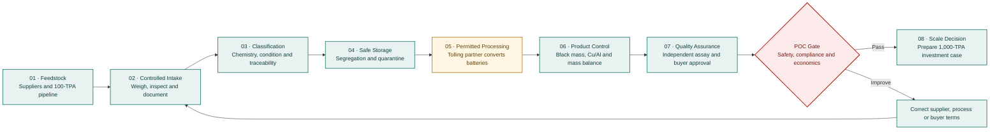
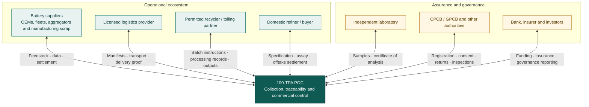

# 100 TPA Black-Mass Proof-of-Concept Roadmap

## Recommended Capacity

**100 TPA is the recommended operational proof-of-concept (POC) scale.** It equals approximately 8.3 tonnes per month, or 0.33 tonnes per working day across 300 operating days. Process it in planned, traceable batches rather than continuous production.

Capacity should progress as follows:

| Scale | Role | Decision |
|---|---|---|
| 1 TPA | Handling, documentation, and buyer-sample trial | Too small to validate plant economics or justify processing equipment |
| **100 TPA** | **Operational POC** | Validate supply, safety, compliance, black-mass quality, and buyer acceptance |
| 1,000 TPA | First small commercial black-mass plant | Build only after the POC proves reliable feedstock and offtake |

At 100 TPA, do not buy a full shredding line. Use a tolling or trial arrangement with a properly registered and permitted recycler for any battery breaking, shredding, or black-mass processing. This preserves capital while producing the evidence needed for a 1,000-TPA investment.

## POC Workflow

The diagram is deliberately partner-led: at 100 TPA, the business validates the complete controlled workflow before it owns capital-intensive processing equipment.

## POC Context Diagram

The POC remains responsible for traceability and commercial control even when licensed partners perform logistics and processing.

## POC Objectives

- Process 100 tonnes of documented, chemistry-segregated battery feedstock over up to 12 months
- Establish a repeatable chain of custody from supplier to domestic refiner/offtaker
- Demonstrate safe handling, storage, discharge, transport, and batch traceability
- Obtain independent black-mass assays and written buyer feedback
- Measure actual collection, transport, tolling, testing, and selling costs

## Roadmap

| Phase | Target outcome | Evidence required to proceed |
|---|---|---|
| 1. Define the POC | Select feed chemistry, supply source, and domestic refiner/offtaker | Signed POC scope, material specification, and buyer quality requirements |
| 2. Prepare compliance and safety | Establish the legal entity, handling procedures, training, traceability, storage controls, and applicable approvals | Written confirmation of CPCB/GPCB requirements and approved safety plan |
| 3. Secure feedstock | Build a documented 100-TPA supplier pipeline | Supplier LOIs/contracts, chain-of-custody records, weights, and condition records |
| 4. Run partner batches | Process planned batches through the permitted operating model | Processing agreement, batch records, recovery data, and residue-disposal records |
| 5. Qualify output | Produce buyer-evaluated black mass from multiple batches | Certificates of analysis, moisture/contamination results, and written buyer feedback |
| 6. Make the scale decision | Choose whether to launch a 1,000-TPA plant | Actual unit economics, safety review, compliance audit, and signed offtake/supply commitments |

## Required Deliverables

- At least 100 tonnes of fully traceable battery feedstock, segregated by chemistry where possible
- Supplier, transport, permitted-processing, and black-mass offtake/tolling agreements
- Safety and emergency-response procedures
- Batch mass balances: input batteries, black mass, copper, aluminium, residues, and disposal route
- Independent assay results for each representative batch
- Actual unit-cost and cash-cycle model

## Transition: 100 TPA → 1,000 TPA

Build a 1,000-TPA plant only after at least three successful representative batches, a credible pipeline for at least 70% of 1,000-TPA annual feedstock, a domestic buyer or tolling partner with agreed specifications, no unresolved safety or compliance findings, and a positive or clearly improvable contribution margin.
