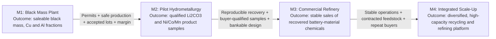

# Lithium-Ion Recycling Milestones

This roadmap builds the business in stages. Do not begin the next capital-intensive stage until the stated transition gate is met and documented.

## Overall Milestone Flow

## M1 — Black Mass Plant

**Directory:** `01-black-mass-plant/`  
**Objective:** Safely receive spent lithium-ion batteries and produce specification-compliant black mass, copper, and aluminium fractions.

Key deliverables:

- Feedstock supply agreements and domestic black-mass tolling/offtake agreements
- Site, environmental, hazardous-waste, fire, and operating approvals
- Discharge, inert shredding, drying, separation, air-pollution control, storage, and QC capability
- Chemistry segregation and independent assay records for NMC/NCA and LFP streams
- Repeatable commercial production and accepted buyer batches

### Transition: M1 → M2

Proceed only after all permits are active, at least three consecutive commercial lots meet buyer specifications, supply and offtake contracts are in force, and the plant has demonstrated safe operation with positive per-tonne contribution margin.

## M2 — Pilot Hydrometallurgy

**Directory:** `02-pilot-hydrometallurgy/`  
**Objective:** Prove the chemical refining route from black mass to lithium carbonate and nickel/cobalt/manganese products at pilot scale.

Key deliverables:

- Chemistry-specific leaching, purification, solvent-extraction, precipitation, and wastewater-treatment process
- Independent recovery, purity, mass-balance, safety, and effluent data
- Qualified product samples accepted by prospective buyers
- Bankable design, capex estimate, and environmental basis for the commercial refinery

### Transition: M2 → M3

Proceed only when pilot results are reproducible, recovery and product quality meet agreed specifications, disposal/ZLD arrangements are proven, and buyers provide written offtake intent.

## M3 — Commercial Refinery

**Directory:** `03-commercial-refinery/`  
**Objective:** Operate a commercial hydrometallurgical refinery producing saleable battery-material chemicals.

Key deliverables:

- Funded, commissioned refinery with trained operations and laboratory teams
- Qualified lithium, nickel, cobalt, and manganese product streams where feed chemistry supports them
- Long-term feedstock, reagent, waste-management, and product-offtake contracts
- Stable operating margins, compliance reporting, and quality-system records

### Transition: M3 → M4

Proceed only when commercial operations are stable, contracted feedstock supports expansion, products have repeat buyers, and the expansion investment meets the approved return and risk thresholds.

## M4 — Integrated Scale-Up

**Directory:** `04-integrated-scale-up/`  
**Objective:** Expand capacity and integrate a resilient, multi-source recycling and refining platform.

Key deliverables include expanded capacity, diversified domestic feedstock, verified imported intermediates where permitted, strategic OEM/cell-maker partnerships, and a mature governance, safety, and environmental system.
